<div align="center">

# TobiTests 🚀
### Framework Autónomo Multi-Agente de QA E2E y Telemetría Visual de Oficina

<p align="center">
  <a href="./README.md"></a>
  <a href="./README.es.md"></a>
  <a href="./README.pt.md"></a>
  <a href="./README.zh.md"></a>
</p>

[](https://playwright.dev/)
[](https://modelcontextprotocol.io/)
[](https://developer.chrome.com/docs/devtools)
[](#trae-tu-propio-agente-byoa-y-co-orquestación-dual)
[](https://github.com/TodoTobi/tobitests/actions)
[](https://opensource.org/licenses/MIT)

</div>

> [!TIP]
> 🌐 **Seleccionar idioma / Select language:**
> * 🇪🇸 **Español (README.es.md)** — Versión actual en Español
> * 🇺🇸 **[English (README.md)](./README.md)** — Original English documentation
> * 🇧🇷 **[Português (README.pt.md)](./README.pt.md)** — Documentação em Português
> * 🇨🇳 **[简体中文 (README.zh.md)](./README.zh.md)** — 完整中文文档

**TobiTests** es un framework de código abierto de **Aseguramiento de Calidad E2E Multi-Agente Autónomo y Telemetría Visual**. Construido sobre el **Model Context Protocol (MCP)**, conecta agentes de IA (Antigravity, Claude Code, OpenCode, Cursor…) con subagentes especializados que inspeccionan tu código fuente, recorren flujos reales en el DOM, auditan la telemetría de red y consola mediante un **Oráculo de Detección de Errores de 3 Capas**, y compilan suites permanentes de Playwright (`.spec.ts`) — ejecutándose localmente en tu máquina.

---

## ⚡ Inicio Rápido en 60 Segundos

```bash
# 1. Clonar e instalar dependencias
git clone https://github.com/TodoTobi/tobitests.git && cd tobitests && npm install

# 2. Iniciar el dashboard visual (http://localhost:5180)
npm run dev:web

# 3. Auditar tu aplicación (reemplaza la URL y el nombre del proyecto)
python scripts/tobitests_cli.py --project my-app --url http://localhost:3000
```


> **Workspace de demostración:** En la grabación se muestra la inspección del workspace demo local sanitizado **Huellicam (`workspaces/vetconnect`)** junto con los datos de auto-auditoría de `tobitests`. ¿Quieres contribuir una guía o grabación? Consulta [CONTRIBUTING.es.md](CONTRIBUTING.es.md).

---

## ✨ ¿Por qué TobiTests?

| Dimensión | Agentes de "Uso de Computadora" (Píxeles) | **Framework TobiTests** |
| :--- | :--- | :--- |
| **Motor de Ejecución** | Coordenadas de ratón del SO y capturas | Chromium Local / CI mediante Playwright y CDP |
| **Conocimiento del Código** | Caja Negra (solo píxeles) | **Caja Blanca Total** (Rutas, esquemas Zod/Joi, stores, AST) |
| **Profundidad de Oráculos** | Solo fallos visuales de aserción | **Oráculo de 3 Capas** (CDP Implícito + Divergencia de Estado + A11y) |
| **Observabilidad de Agentes** | Logs de texto en terminal | **Mapa de Flujo Interactivo + Oficina Isométrica 2.5D** |
| **Costos** | Alto consumo de tokens de visión | Código abierto (MIT) — ejecútalo localmente o en CI sin costo |

---

## 🔄 El Pipeline Autónomo Local de QA en 8 Pasos

TobiTests estandariza la verificación de extremo a extremo en un **Pipeline de 8 Pasos** documentado en [`docs/ARCHITECTURE.md`](docs/ARCHITECTURE.md):

```mermaid
flowchart LR
    S1["1. Bootstrap y Descubrimiento de Stack"] --> S2["2. Análisis de Código y Rutas"]
    S2 --> S3["3. PRD Normalizado (Ground Truth JSON)"]
    S3 --> S4["4. Generación de Matriz de Pruebas"]
    S4 --> S5["5. Síntesis de Specs (.spec.ts)"]
    S5 --> S6["6. Ejecución Aislada (.webm y Trazas)"]
    S6 --> S7["7. Triaje y Oráculo de 3 Capas"]
    S7 --> S8["8. Reporte Gherkin y Auto-Sanación"]
```



1. **Bootstrap y Descubrimiento de Puertos/Stack:** Detecta puertos de frontend/backend, stack de frameworks (`Next.js`, `React + Vite`, `Vue`, `Node.js`) e inicializa el espacio de trabajo.
2. **Análisis de Código Fuente y Rutas:** Análisis estático de caja blanca de definiciones de enrutadores, guards de autenticación, stores de estado (`React Query`, `Zustand`, `Context`) y esquemas de validación.
3. **Generación de PRD Normalizado (`prd-ground-truth.json`):** Sintetiza una especificación legible por máquina dentro de `workspaces/<proyecto>/`.
4. **Generación de Matriz de Pruebas (`test-matrix.json`):** Divide las pruebas en **Happy Paths**, **Fuzzing de Casos Límite/Negativos**, **Límites de Seguridad RBAC** y **UI/UX/A11y**.
5. **Síntesis de Specs de Playwright (`specs/*.spec.ts`):** Genera especificaciones semánticas sin esperas arbitrarias (`sleep`), utilizando `getByRole`, `getByLabel` y `getByTestId`.
6. **Ejecución Aislada con Video (`.webm`), Capturas y Trazas:** Ejecuta pruebas en contextos aislados capturando video `.webm`, capturas `.png` por paso y métricas de impacto por ruta.
7. **Triaje y Oráculo de Divergencia de 3 Capas:** Evalúa cada paso a través de la **Capa 1 (CDP Implícito)**, **Capa 2 (Divergencia de Estado)** y **Capa 3 (Visual y A11y)**, clasificando fallos desde `critical` (`P0`) hasta `low` (`P3`).
8. **Reporte Gherkin y Auto-Sanación de Selectores:** Emite tarjetas de error estructuradas en **Gherkin (`Given`/`When`/`Then`/`But`)** con coordenadas exactas de código fuente (`root_cause_file`, `root_cause_line`) y repara automáticamente derivas de selectores.

---

## 🤝 Trae tu Propio Agente (BYOA) y Co-Orquestación Dual

TobiTests es agnóstico respecto al agente. La configuración por defecto vincula a **Antigravity** (Cerebro Analítico) con **OpenCode** (Ejecutor Determinista), pero permite conectar cualquier agente o entorno:

* **Motores Compatibles:** `antigravity`, `opencode`, `claude-code`, `cursor`, `codex`, `windsurf` y `custom`.
* **Intercambio Dinámico de Roles:** Define quién es el **Líder Principal** (Pasos 1–4, 7) y quién es el **Ejecutor Secundario** (Pasos 5, 6, 8), o inviértelos en 1 clic (`--swap-agents`).
* **Modo Solo (Agente Único):** ¿Trabajas con un solo agente? Activa el **Modo Solo** (`--mode single`) y el agente seleccionado ejecutará los 8 pasos de inicio a fin sin esperar relevos.
* **Autodetección de Entorno:** Reconoce automáticamente herramientas CLI y reglas instaladas (`.cursorrules`, `CLAUDE.md`, `opencode.json`, `CODEX.md`, `.windsurfrules`).

| Rol de Agente | Motor por Defecto | Opciones Soportadas | Enfoque Principal | Herramientas / MCP |
| :--- | :--- | :--- | :--- | :--- |
| **Líder Principal** | **Antigravity** | `antigravity`, `claude-code`, `cursor`, `opencode`, `codex`, `windsurf`, `custom` | Análisis de caja blanca, PRD/Matriz, triaje de 3 oráculos | Sistema de archivos, Búsqueda, Pizarra compartida |
| **Ejecutor Secundario** | **OpenCode** | `opencode`, `claude-code`, `antigravity`, `cursor`, `codex`, `windsurf`, `custom` | Síntesis de specs, ejecución CLI Playwright, auto-sanación | `@opencode/deepseek`, `npx playwright test` |
| **Explorer QA** | Especializado | Subagente | Simulación de flujos de usuario, pruebas negativas, DOM | `@playwright/mcp` (`browser_navigate`, `browser_snapshot`) |
| **Telemetry Auditor** | Especializado | Subagente | Captura de excepciones en ejecución, HTTP `>= 400` y timeouts | `@chromedevtools/chrome-devtools-mcp` + listeners CDP |
| **Spec Writer** | Especializado | Subagente | Traducción de flujos validados a `.spec.ts` deterministas | Playwright Test API (`specs/*.spec.ts`) |

---

## 🔬 El Oráculo de Detección de 3 Capas y Rúbrica P0–P3

Definido en [`docs/TESTING_PROTOCOL.md`](docs/TESTING_PROTOCOL.md), los subagentes identifican y clasifican defectos sin depender únicamente de aserciones manuales:

1. **Capa 1 — Oráculo Implícito (Chrome DevTools MCP y Listeners de Ejecución):**
   Captura `pageerror`, `Uncaught Exception`, `console.error`, respuestas HTTP `>= 400` inesperadas y peticiones colgadas (`> 3000ms`) en WebSockets, WebRTC o APIs vía `list_console_messages`, `list_network_requests` y `page.on('pageerror' | 'console' | 'response')`.
2. **Capa 2 — Oráculo de Divergencia de Estado (Playwright MCP + Código Fuente):**
   Compara la máquina de estados deducida del código fuente contra el DOM renderizado en vivo tras cada mutación para detectar desincronizaciones entre vistas o roles (ej. un elemento cancelado en la Vista A que sigue activo en la Vista B por falta de invalidación de caché).
3. **Capa 3 — Oráculo Visual y de Accesibilidad (Snapshots DOM y Estilos Computados):**
   Detecta controles interactivos bloqueados (`pointer-events: none`), desbordamiento horizontal (`scrollWidth > clientWidth`), problemas de cierre en modales (`Escape` / clic en backdrop) y violaciones críticas de accesibilidad WCAG/ARIA.

### Rúbrica de Severidad e Impacto
* 🔴 **`critical` (P0 — Bloqueante):** Caída total de la app (pantalla blanca), HTTP `500` en flujos centrales (Autenticación/Pagos), vulnerabilidad RBAC o pérdida de datos.
* 🟠 **`high` (P1 — Mayor):** Divergencia de estado entre roles/vistas, flujo principal roto sin alternativa evidente, o timeout en servicios en tiempo real (WebRTC/WebSockets).
* 🟡 **`medium` (P2 — Menor):** Validaciones de formulario faltantes, datos desactualizados en modales secundarios, o fallas de UI con solución sencilla.
* 🔵 **`low` (P3 — Trivial / UI):** Mezclas de idioma, desalineación visual menor, advertencias `console.warn` no críticas o pequeños roces de usabilidad.

---

## 🖥️ Suite de Observabilidad Visual (`web/`)

La plataforma web de TobiTests (`web/src/`) proporciona tres estudios principales:

1. **Canvas Interactivo de Rutas y Journeys ([`JourneyCanvas.tsx`](web/src/components/JourneyCanvas.tsx)):**
   * Mapa de flujo con nodos y curvas Bézier (`rm-frame`, `rm-hi`, `rm-has-fail`) mostrando capturas de pantalla de rutas, conteo de pruebas por pantalla, toques de navegación y distintivos de fallo.
   * Pasa el cursor sobre cualquier prueba en el drawer colapsable para trazar su trayectoria completa de izquierda a derecha; haz clic en cualquier píldora de conexión para ver el agente ejecutor, herramienta MCP, selector de Playwright y duración.
2. **"La Oficina" Centro de Comando Isométrico 2.5D ([`OfficeScene.tsx`](web/src/components/OfficeScene.tsx) y [`OfficeView.tsx`](web/src/components/OfficeView.tsx)):**
   * Simulación 2.5D en tiempo real de **Antigravity**, **Explorer QA**, **Telemetry Auditor**, **Spec Writer** y **OpenCode** en sus estaciones, servidores y reuniones standup, sincronizada con `web/public/data/antigravity-live.json`.
3. **Estudio de Diagnóstico y Reproducción ([`TestDetailModal.tsx`](web/src/components/TestDetailModal.tsx)):**
   * Enfoca automáticamente los pasos fallidos, reproduce videos `.webm` integrados junto a capturas por paso, y proporciona con un clic prompts **Gherkin/BDD + Cerco Anti-Regresión** y diagnóstico de causa raíz de caja blanca (`root_cause_file` y `root_cause_line`).

---

## ⚡ Modos Operativos y Guía de Uso

> 📖 **Manuales Completos de Operación:**
> * **[`docs/USER_GUIDE.md`](docs/USER_GUIDE.md):** Guía práctica para **Aplicaciones Web Frontend/Full-Stack**, **APIs Backend Puras / REST**, **Vista Previa Estática** y **Prompts de Copiar y Pegar** para Antigravity y OpenCode.
> * **[`docs/MCP_SETUP.md`](docs/MCP_SETUP.md):** Configuración detallada de MCP para **Antigravity IDE**, **OpenCode CLI** ([`opencode.json`](opencode.json)), **Cursor** y **Claude Code**.

### Modo 1: Demo Interactiva (Workspaces Pre-Cargados)
TobiTests incluye dos espacios de trabajo pre-auditados listos para explorar localmente con `vite` (o alojar como sitio estático en un **dominio raíz** como Vercel/Netlify — nota que `web/src/` usa rutas relativas a la raíz `/data/...` y `/evidence/...`, por lo que no es compatible con subrutas como `github.io/tobitests/`):
* **`TobiTests (Self-Audit)`:** 5 suites, 84 pruebas, 1 bug resuelto (`BUG-01`), mapa de flujo (incluyendo nodos de telemetría de contratos API), reporter nativo de pasos (`tobi-steps-reporter.ts`) y grabaciones `.webm` de auto-auditoría.
* **`Huellicam (VetConnect)` (`workspaces/vetconnect`):** 9 pruebas registradas y 3 bugs documentados en Gherkin (`BUG-AUTO-01` a `BUG-AUTO-03`, resueltos) con trazas de diagnóstico y specs.

```bash
# 1. Clonar e instalar dependencias
git clone https://github.com/TodoTobi/tobitests.git
cd tobitests
npm install
npm --prefix web install

# 2. Iniciar el Dashboard de Observabilidad Visual (http://localhost:5180)
npm run dev:all

# 3. Compilar el paquete de producción (para vite preview local o hosting en dominio raíz)
npm run build:web
```

### Modo 2: Auditar Cualquier Proyecto Frontend, API Backend o Full-Stack Local (`--scope`)
TobiTests permite **seleccionar dinámicamente el alcance de auditoría (`frontend` | `backend` | `fullstack`)** tanto al inicializar el proyecto (en el selector de 3 tarjetas de `+ Agregar Proyecto` o mediante `--scope` en CLI) como **en tiempo real tras las pruebas** mediante el selector superior (`🖥️ Frontend` | `⚙️ Backend API` | `🔗 Full-Stack`) y el botón **`⚡ Re-auditar alcance`**, con **fusión incremental** entre ejecuciones:

```bash
# 1. Inicializar el espacio de trabajo del proyecto objetivo (Pasos 1–4):
#    Elige --scope frontend (UI E2E), --scope backend (API pura { request }), o --scope fullstack (ambos)
npm run audit:init -- --project mi-app --repo "C:/ruta/a/mi-app" --url "http://localhost:3000" --scope fullstack

# 2. Ejemplo de Fusión Incremental: Auditar Frontend primero y luego agregar Backend sin perder resultados:
python scripts/tobitests_cli.py --project mi-app --url "http://localhost:3000" --scope frontend
python scripts/tobitests_cli.py --project mi-app --url "http://localhost:3000" --scope backend

# 3. Ejecutar Suites de Playwright E2E/API e Inyectar Resultados en la UI (Pasos 6–7):
npm run audit:run -- --project mi-app --scope fullstack --run-playwright

# 4. Actualizar el Estado de la Pizarra Compartida durante la Co-Orquestación:
npm run audit -- --status exploring --orchestrator antigravity --step 2 --scope fullstack
npm run audit -- --status writing_specs --orchestrator opencode --step 5 --scope fullstack
npm run audit -- --status auditing_telemetry --orchestrator antigravity --step 7 --scope fullstack
npm run audit -- --status standup_meeting --orchestrator antigravity --step 8 --scope fullstack
```

### Modo 3: Configurar Servidores MCP en tu Cliente de IA
Consulta **[`docs/MCP_SETUP.md`](docs/MCP_SETUP.md)** para instrucciones completas. El archivo [`.mcp.json`](.mcp.json) en la raíz registra `tobitests`, `playwright` y `chrome-devtools` automáticamente para Claude Code, o puedes agregar `@playwright/mcp` y `@chromedevtools/chrome-devtools-mcp` a tu cliente de IA (`mcp_config.json` / [`opencode.json`](opencode.json) / `.cursor/mcp.json`):

```json
{
  "mcpServers": {
    "playwright": {
      "command": "npx",
      "args": ["@playwright/mcp@latest"]
    },
    "chrome-devtools": {
      "command": "npx",
      "args": ["-y", "@chromedevtools/chrome-devtools-mcp@latest"]
    }
  }
}
```

---

## 📂 Estructura del Repositorio

```text
tobitests/
├── docs/                           # Suite Maestra de Documentación
│   ├── USER_GUIDE.md               # Manual operativo diario (Frontend, API Backend y Prompts)
│   ├── MCP_SETUP.md                # Guía de configuración MCP (Antigravity, OpenCode, Cursor, Claude)
│   ├── ARCHITECTURE.md             # Pipeline de 8 Pasos y esquemas JSON
│   ├── TESTING_PROTOCOL.md         # Oráculo de 3 Capas, Rúbrica P0-P3 y Contrato Gherkin
│   └── FIGMA_AI_PROMPT_SPEC.md     # Especificación de diseño de UI/UX
├── scripts/                        # Scripts agnósticos del CLI central, MCP y puente (5 scripts)
│   ├── tobitests_cli.py            # Inicializador agnóstico, escáner de rutas/APIs y CLI de Pizarra
│   ├── tobitests_mcp.py            # Servidor MCP nativo que expone herramientas de TobiTests por stdio
│   ├── ingest_playwright_results.py# Puente automático de reportes JSON de Playwright a la UI
│   ├── run_deep_audit.py           # Ejecutor de auditoría profunda multi-oráculo
│   └── sync_specs.py               # Observador en tiempo real de .spec.ts y sincronizador de UI
├── templates/                      # Plantillas oficiales de especificaciones de Playwright
│   ├── sample.spec.ts              # Plantilla para Frontend UI / DOM ({ page })
│   └── sample-api.spec.ts          # Plantilla para Backend / API REST ({ request } 2xx/4xx/RBAC/Race)
├── specs/                          # Especificaciones permanentes de pruebas Playwright (.spec.ts)
├── workspaces/                     # PRDs, Matrices de prueba y scripts desacoplados por proyecto
│   ├── tobitests/                  # PRD, matriz y telemetría de auto-auditoría de TobiTests
│   ├── tobitests-self-audit/       # Scripts de evidencia y PRD de referencia de auto-auditoría
│   └── vetconnect/                 # Workspace demo sanitizado de Huellicam (VetConnect) (9 pruebas, 3 bugs Gherkin)
├── web/                            # Aplicación de Observabilidad Visual en React + TypeScript + Vite
│   ├── public/data/                # JSONs de estado en vivo, projects.json y Pizarra Compartida
│   ├── public/evidence/            # Videos .webm y capturas .png registradas
│   └── src/components/             # JourneyCanvas.tsx, OfficeScene.tsx, TestDetailModal.tsx
├── AGENTS.md                       # Manifiesto de topología de agentes, CLI y Pizarra Compartida
├── AGENT_INSTRUCTIONS.md           # Manual operativo autónomo para agentes de código
├── CLAUDE.md                       # Guía y referencia CLI para Claude Code
├── .mcp.json                       # Registro MCP sin configuración previa (tobitests, playwright, chrome-devtools)
├── pyproject.toml                  # Metadatos del paquete Python y comandos (`tobitests`, `tobitests-mcp`)
├── opencode.json                   # Configuración de co-orquestación para OpenCode CLI
└── package.json                    # Scripts del proyecto ("audit:init", "audit:run", "dev:all", "verify")
```

---

## 🤝 Comunidad y Gobernanza

* **[Guía de Contribución](CONTRIBUTING.es.md)** ([English](CONTRIBUTING.md))
* **[Política de Seguridad](SECURITY.es.md)** ([English](SECURITY.md))
* **[Código de Conducta](CODE_OF_CONDUCT.es.md)** ([English](CODE_OF_CONDUCT.md))
* **[Registro de Cambios (Changelog)](CHANGELOG.md)**

---

## 🛡️ Licencia
Distribuido bajo la **Licencia MIT**. Consulta [`LICENSE`](LICENSE) para más información.
