<div align="center">

# TobiTests 🚀
### Framework Autónomo Multi-Agente de QA E2E y Telemetría Visual de Oficina

<p align="center">
  <a href="./README.md"></a>
  <a href="./README.es.md"></a>
  <a href="./README.pt.md"></a>
  <a href="./README.zh.md"></a>
</p>

[](https://playwright.dev/)
[](https://modelcontextprotocol.io/)
[](https://developer.chrome.com/docs/devtools)
[](#orquestaci%C3%B3n-dual-y-trae-tu-propio-agente-byoa)
[](https://github.com/TodoTobi/tobitests/actions)
[](https://opensource.org/licenses/MIT)

</div>

> [!TIP]
> 🌐 **Seleccionar idioma / Select language:**
> * 🇪🇸 **Español (README.es.md)** — Versión actual en Español
> * 🇺🇸 **[English (README.md)](./README.md)** — Original English documentation
> * 🇧🇷 **[Português (README.pt.md)](./README.pt.md)** — Documentação em Português
> * 🇨🇳 **[简体中文 (README.zh.md)](./README.zh.md)** — 完整中文文档

> **"Un estudio autónomo de QA y diagnóstico 100% local y de código abierto. Combina inteligencia de código de caja blanca, actuación Playwright MCP, telemetría CDP de Chrome DevTools y una oficina 2.5D de agentes en tiempo real, sin límites ni cuotas en la nube."**

**TobiTests** es un framework de **Aseguramiento de Calidad E2E Multi-Agente Autónomo y Telemetría Visual** diseñado como una alternativa local de caja blanca frente a plataformas comerciales en la nube como TestSprite. Construido sobre el **Model Context Protocol (MCP)**, une agentes como **Antigravity**, **OpenCode**, **Claude Code** o **Cursor** con subagentes especializados que inspeccionan tu código fuente, exploran rutas en vivo en el DOM, auditan la telemetría de red/consola mediante un **Oráculo de Detección de Errores de 3 Capas** y generan suites permanentes y auto-reparables en Playwright (`.spec.ts`).

---

## ✨ ¿Por qué TobiTests?

| Dimensión | Agentes de "Uso de Computadora" (Píxeles) | QA SaaS en la Nube (ej. TestSprite) | **Framework TobiTests** |
| :--- | :--- | :--- | :--- |
| **Motor de Ejecución** | Coordenadas de ratón y capturas de pantalla | MicroVMs propietarias en la nube | **100% Chromium Local / CI mediante Playwright y CDP** |
| **Conocimiento del Código** | Caja Negra (solo píxeles) | Mayormente Caja Negra / Subida de PRDs | **Caja Blanca Total** (Rutas, esquemas Zod/Joi, stores, AST) |
| **Profundidad de Oráculos** | Fallos visuales de aserción | Logs estándar HTTP y aserciones | **Oráculo de 3 Capas** (CDP Implícito + Divergencia de Estado + A11y) |
| **Observabilidad de Agentes**| Logs de texto en terminal | Dashboard estático en la nube | **Mapa de Flujo Interactivo + Oficina Isométrica 2.5D** |
| **Costos y Cuotas** | Alto consumo de tokens de visión | Suscripción paga y límites de ejecución | **100% Open Source, Ejecuciones Ilimitadas en Local y CI** |

---

## 🔄 El Pipeline Autónomo Local de QA en 8 Pasos

TobiTests estandariza la verificación de extremo a extremo en un **Pipeline de 8 Pasos** documentado en [`docs/ARCHITECTURE.md`](docs/ARCHITECTURE.md):

```mermaid
flowchart LR
    S1["1. Bootstrap y Descubrimiento de Stack"] --> S2["2. Análisis de Código y Rutas"]
    S2 --> S3["3. PRD Normalizado (Ground Truth JSON)"]
    S3 --> S4["4. Generación de Matriz de Pruebas"]
    S4 --> S5["5. Síntesis de Specs (.spec.ts)"]
    S5 --> S6["6. Ejecución Aislada (.webm y Trazas)"]
    S6 --> S7["7. Triaje y Oráculo de 3 Capas"]
    S7 --> S8["8. Reporte Gherkin y Auto-Sanación"]
```



1. **Bootstrap y Descubrimiento de Puertos/Stack:** Detecta puertos de frontend/backend, stack de frameworks (`Next.js`, `React + Vite`, `Vue`, `Node.js`) e inicializa el espacio de trabajo.
2. **Análisis de Código Fuente y Rutas:** Análisis estático de caja blanca de definiciones de enrutadores, guards de autenticación, stores de estado (`React Query`, `Zustand`, `Context`) y esquemas de validación.
3. **Generación de PRD Normalizado (`prd-ground-truth.json`):** Sintetiza una especificación autoritativa legible por máquina dentro de `workspaces/<proyecto>/`.
4. **Generación de Matriz de Pruebas (`test-matrix.json`):** Divide las pruebas en **Happy Paths**, **Fuzzing de Casos Límite/Negativos**, **Límites de Seguridad RBAC** y **UI/UX/A11y**.
5. **Síntesis de Specs de Playwright (`specs/*.spec.ts`):** Genera especificaciones semánticas sin esperas arbitrarias (`sleep`), utilizando `getByRole`, `getByLabel` y `getByTestId`.
6. **Ejecución Aislada con Video (`.webm`), Capturas y Trazas:** Ejecuta pruebas en contextos aislados capturando video `.webm`, capturas `.png` por paso y métricas de impacto por ruta.
7. **Triaje y Oráculo de Divergencia de 3 Capas:** Evalúa cada paso a través de la **Capa 1 (CDP Implícito)**, **Capa 2 (Divergencia de Estado)** y **Capa 3 (Visual y A11y)**, clasificando fallos desde `critical` (`P0`) hasta `low` (`P3`).
8. **Reporte Gherkin y Auto-Sanación de Selectores:** Emite tarjetas de error estructuradas en **Gherkin (`Given`/`When`/`Then`/`But`)** con coordenadas exactas de código fuente (`root_cause_file`, `root_cause_line`) y repara automáticamente derivas de selectores.

---

## 🤝 Trae tu Propio Agente (BYOA) y Co-Orquestación Dual

TobiTests es 100% agnóstico respecto al agente. La configuración por defecto vincula a **Antigravity** (Cerebro Analítico) con **OpenCode** (Ejecutor Determinista), pero permite conectar cualquier agente o entorno:

* **Motores Compatibles:** `antigravity`, `opencode`, `claude-code`, `cursor`, `codex`, `windsurf` y `custom`.
* **Intercambio Dinámico de Roles:** Define quién es el **Líder Principal** (Pasos 1–4, 7) y quién es el **Ejecutor Secundario** (Pasos 5, 6, 8), o inviértelos con 1 clic (`--swap-agents`).
* **Modo Solo (Agente Único):** ¿Trabajando con un solo agente? Activa el **Modo Solo** (`--mode single`) y el agente seleccionado ejecutará los 8 pasos de inicio a fin sin esperar relevos.
* **Autodetección de Entorno:** Reconoce automáticamente herramientas CLI y reglas instaladas (`.cursorrules`, `CLAUDE.md`, `opencode.json`, `CODEX.md`, `.windsurfrules`).

| Rol de Agente | Motor por Defecto | Opciones Soportadas | Enfoque Principal | Herramientas / MCP |
| :--- | :--- | :--- | :--- | :--- |
| **Líder Principal** | **Antigravity** | `antigravity`, `claude-code`, `cursor`, `opencode`, `codex`, `windsurf`, `custom` | Análisis de caja blanca, PRD/Matriz, triaje de 3 oráculos | Sistema de archivos, Búsqueda, Pizarra compartida |
| **Ejecutor Secundario** | **OpenCode** | `opencode`, `claude-code`, `antigravity`, `cursor`, `codex`, `windsurf`, `custom` | Síntesis de specs, ejecución CLI Playwright, auto-sanación | `@opencode/deepseek`, `npx playwright test` |
| **Explorer QA** | Especializado | Subagente | Simulación de flujos de usuario, pruebas negativas, DOM | `@playwright/mcp` (`browser_navigate`, `browser_snapshot`) |
| **Telemetry Auditor** | Especializado | Subagente | Captura de excepciones en ejecución, HTTP `>= 400` y timeouts | `@chromedevtools/chrome-devtools-mcp` + listeners CDP |
| **Spec Writer** | Especializado | Subagente | Traducción de flujos validados a `.spec.ts` deterministas | Playwright Test API (`specs/*.spec.ts`) |

---

## 🔬 El Oráculo de Detección de 3 Capas y Rúbrica P0–P3

Definido en [`docs/TESTING_PROTOCOL.md`](docs/TESTING_PROTOCOL.md), los subagentes identifican y clasifican defectos sin depender de aserciones humanas frágiles:

1. **Capa 1 — Oráculo Implícito (Chrome DevTools MCP y Listeners de Ejecución):**
   Captura `pageerror`, `Uncaught Exception`, `console.error`, respuestas HTTP `>= 400` inesperadas y peticiones bloqueadas (`> 3000ms`) en WebSockets, WebRTC o APIs vía `list_console_messages`, `list_network_requests` y listeners de Playwright.
2. **Capa 2 — Oráculo de Divergencia de Estado (Playwright MCP + Código Fuente):**
   Compara la máquina de estados deducida del código fuente contra el DOM renderizado en vivo tras cada mutación para detectar desincronizaciones entre vistas o roles (ej. un elemento cancelado en la Vista A que sigue activo en la Vista B por falta de invalidación de caché).
3. **Capa 3 — Oráculo Visual y de Accesibilidad (Snapshots DOM y Estilos Computados):**
   Detecta controles interactivos bloqueados (`pointer-events: none`), desbordamiento horizontal (`scrollWidth > clientWidth`), problemas de cierre en modales (`Escape` / click en backdrop) y violaciones críticas de accesibilidad WCAG/ARIA.

### Rúbrica de Severidad e Impacto
* 🔴 **`critical` (P0 — Bloqueante):** Caída total de la app (pantalla blanca), HTTP `500` en flujos centrales (Autenticación/Pagos), vulnerabilidad RBAC o pérdida de datos.
* 🟠 **`high` (P1 — Mayor):** Divergencia de estado entre roles/vistas, flujo principal roto sin alternativa evidente, o timeout en servicios en tiempo real.
* 🟡 **`medium` (P2 — Menor):** Validaciones de formulario faltantes, datos desactualizados en modales secundarios, o fallas de UI con solución sencilla.
* 🔵 **`low` (P3 — Trivial / UI):** Errores de traducción, desalineación visual menor, advertencias no críticas en consola, o pequeños roces de usabilidad.

---

## 🖥️ Suite de Observabilidad Visual (`web/`)

La plataforma web de TobiTests (`web/src/`) proporciona tres módulos principales:

1. **Canvas Interactivo de Rutas y Journeys ([`JourneyCanvas.tsx`](web/src/components/JourneyCanvas.tsx)):**
   * Mapa de flujo interactivo con nodos y curvas Bézier (`rm-frame`, `rm-hi`, `rm-has-fail`) mostrando capturas de pantalla de rutas, conteo de pruebas por pantalla, toques de navegación y distintivos de fallo.
   * Drawer lateral colapsable para inspeccionar trayectorias completas de izquierda a derecha y píldoras de conexión con información del agente ejecutor, herramienta MCP, selector de Playwright y duración.
2. **"La Oficina" Centro de Comando Isométrico 2.5D ([`OfficeScene.tsx`](web/src/components/OfficeScene.tsx) y [`OfficeView.tsx`](web/src/components/OfficeView.tsx)):**
   * Simulación 2.5D en tiempo real de **Antigravity**, **Explorer QA**, **Telemetry Auditor**, **Spec Writer** y **OpenCode** trabajando en sus escritorios, servidores y reuniones standup, sincronizada con `web/public/data/antigravity-live.json`.
3. **Estudio de Diagnóstico y Reproducción ([`TestDetailModal.tsx`](web/src/components/TestDetailModal.tsx)):**
   * Enfoca automáticamente los pasos fallidos, reproduce videos `.webm` integrados junto a capturas por paso, y genera con un clic prompts **Gherkin/BDD + Cerco Anti-Regresión** y diagnóstico de causa raíz de caja blanca (`root_cause_file` y `root_cause_line`).

---

## ⚡ Inicio Rápido y Modos Operativos

> 📖 **Manuales Completos de Operación:**
> * **[`docs/USER_GUIDE.md`](docs/USER_GUIDE.md):** Guía práctica para **Aplicaciones Web Frontend/Full-Stack**, **APIs Backend Puras / REST**, **Despliegue de Portafolio Estático** y **Prompts de Copiar y Pegar**.
> * **[`docs/MCP_SETUP.md`](docs/MCP_SETUP.md):** Configuración detallada de MCP para **Antigravity IDE**, **OpenCode CLI** ([`opencode.json`](opencode.json)), **Cursor** y **Claude Code**.

### Modo 1: Demo Interactiva de Portafolio (Proyectos Pre-Cargados)
TobiTests incluye dos espacios de trabajo completos y pre-auditados listos para explorar en el navegador (o desplegar como sitio estático en Vercel o GitHub Pages):
* **`TobiTests (Self-Audit)`:** 5 suites, 84 pruebas E2E, mapa de flujo (incluyendo telemetría de contratos API) y grabaciones de video `.webm`.
* **`VetConnect`:** 6 suites, 108 pruebas E2E y 4 bugs reales documentados en Gherkin (`BUG-01` a `BUG-04`) con videos de reproducción.

```bash
# 1. Clonar e instalar dependencias (instala automáticamente la raíz y web mediante postinstall)
git clone https://github.com/TodoTobi/tobitests.git
cd tobitests
npm install

# 2. Iniciar el Dashboard de Observabilidad Visual + Watcher en vivo (http://localhost:5173)
npm run dev:all

# 3. Compilar el paquete de producción (para Vercel / GitHub Pages)
npm run build:web
```

### Modo 2: Auditar Cualquier Proyecto Frontend, API Backend o Full-Stack Local (`--scope`)
TobiTests permite **seleccionar dinámicamente el alcance de auditoría (`frontend` | `backend` | `fullstack`)** tanto al crear el proyecto (en el selector de 3 tarjetas de `+ Agregar Proyecto` o mediante `--scope` en el CLI) como **en caliente tras las pruebas** mediante el selector superior (`🖥️ Frontend` | `⚙️ Backend API` | `🔗 Full-Stack`), con **fusión incremental** entre ejecuciones:

```bash
# 1. Inicializar el espacio de trabajo del proyecto objetivo (Pasos 1–4):
npm run audit:init -- --project mi-app --repo "C:/ruta/a/mi-app" --url "http://localhost:3000" --scope fullstack

# 2. Ejemplo de Fusión Incremental: Auditar Frontend primero y luego agregar Backend sin perder resultados:
python scripts/tobitests_cli.py --project mi-app --url "http://localhost:3000" --scope frontend
python scripts/tobitests_cli.py --project mi-app --url "http://localhost:3000" --scope backend

# 3. Ejecutar Suites de Playwright E2E/API e Inyectar Resultados en la UI (Pasos 6–7):
npm run audit:run -- --project mi-app --scope fullstack --run-playwright

# 4. Actualizar el Estado de la Pizarra Compartida durante la Co-Orquestación:
npm run audit -- --status exploring --orchestrator antigravity --step 2 --scope fullstack
npm run audit -- --status writing_specs --orchestrator opencode --step 5 --scope fullstack
npm run audit -- --status auditing_telemetry --orchestrator antigravity --step 7 --scope fullstack
npm run audit -- --status standup_meeting --orchestrator antigravity --step 8 --scope fullstack
```

### Modo 3: Configurar Servidores MCP en tu Cliente de IA
Consulta **[`docs/MCP_SETUP.md`](docs/MCP_SETUP.md)** para instrucciones completas. Agrega `@playwright/mcp` y `@chromedevtools/chrome-devtools-mcp` a la configuración de tu cliente de IA (`mcp_config.json` / [`opencode.json`](opencode.json) / `.cursor/mcp.json`):

```json
{
  "mcpServers": {
    "playwright": {
      "command": "npx",
      "args": ["@playwright/mcp@latest"]
    },
    "chrome-devtools": {
      "command": "npx",
      "args": ["-y", "@chromedevtools/chrome-devtools-mcp@latest"]
    }
  }
}
```

---

## 📂 Estructura del Repositorio

```text
tobitests/
├── .agents/                        # Prompts de sistema para los 4 subagentes especializados de QA
│   ├── orchestrator.md             # Co-Orquestación Antigravity + OpenCode y protocolo de Pizarra
│   ├── explorer-qa.md              # Actuador Playwright MCP y explorador de comportamiento/APIs
│   ├── telemetry-auditor.md        # Auditor Chrome DevTools MCP e inspector de causa raíz de caja blanca
│   └── spec-writer.md              # Sintetizador determinista de .spec.ts ({ page } y { request })
├── docs/                           # Suite Maestra de Documentación
│   ├── USER_GUIDE.md               # Manual operativo diario (Frontend, API Backend y Prompts)
│   ├── MCP_SETUP.md                # Guía de configuración MCP (Antigravity, OpenCode, Cursor, Claude)
│   ├── ARCHITECTURE.md             # Pipeline de 8 Pasos, REA de TestSprite v3 y esquemas JSON
│   ├── TESTING_PROTOCOL.md         # Oráculo de 3 Capas, Rúbrica P0-P3 y Contrato Gherkin
│   └── FIGMA_AI_PROMPT_SPEC.md     # Especificación de diseño de UI/UX
├── scripts/                        # Scripts agnósticos del CLI central (estrictamente 4 scripts)
│   ├── tobitests_cli.py            # Inicializador agnóstico, escáner de rutas/APIs y CLI de Pizarra
│   ├── ingest_playwright_results.py# Puente automático de reportes JSON de Playwright a la UI
│   ├── run_deep_audit.py           # Ejecutor de auditoría profunda multi-oráculo
│   └── sync_specs.py               # Observador en tiempo real de .spec.ts y sincronizador de UI
├── templates/                      # Plantillas oficiales de especificaciones de Playwright
│   ├── sample.spec.ts              # Plantilla para Frontend UI / DOM ({ page })
│   └── sample-api.spec.ts          # Plantilla para Backend / API REST ({ request } 2xx/4xx/RBAC/Race)
├── specs/                          # Especificaciones permanentes de pruebas Playwright (.spec.ts)
├── workspaces/                     # PRDs, Matrices de prueba y scripts desacoplados por proyecto
│   ├── tobitests-self-audit/       # 5 suites / 84 pruebas de auto-auditoría
│   └── vetconnect-demo/            # 6 suites / 108 pruebas de VetConnect, 4 bugs y scripts
├── web/                            # Aplicación de Observabilidad Visual en React + TypeScript + Vite
│   ├── public/data/                # JSONs de estado en vivo, projects.json y Pizarra Compartida
│   ├── public/evidence/            # Videos .webm y capturas .png registradas
│   └── src/components/             # JourneyCanvas.tsx, OfficeScene.tsx, TestDetailModal.tsx
├── AGENTS.md                       # Manifiesto de topología de agentes, CLI y Pizarra Compartida
├── AGENT_INSTRUCTIONS.md           # Manual operativo autónomo para agentes de código
├── CLAUDE.md                       # Guía y referencia CLI para Claude Code
├── .cursorrules                    # Reglas para Cursor IDE
├── opencode.json                   # Configuración de co-orquestación para OpenCode CLI
└── package.json                    # Scripts del proyecto ("audit:init", "audit:run", "dev:all", "test")
```

---

## 🛡️ Licencia
Distribuido bajo la **Licencia MIT**. Consulta [`LICENSE`](LICENSE) para más información.
