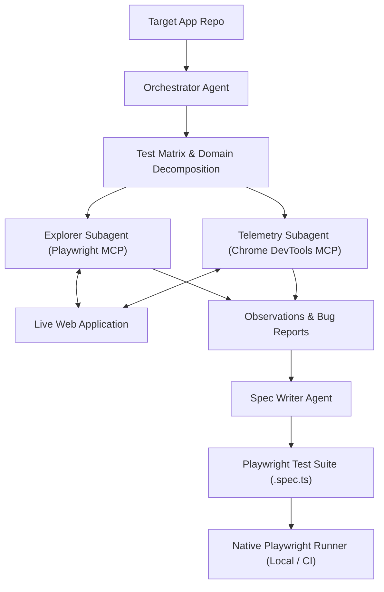

# TobiTests 🚀

An autonomous, multi-agent E2E testing and diagnostic framework inspired by TestSprite. Powered by Model Context Protocol (MCP), Playwright, and Chrome DevTools Protocol.

---

## 🎯 Vision & Purpose

TobiTests bridges the gap between AI-driven development ("vibe coding") and production-grade reliability. Rather than relying on fragile computer-use automation or manual testing scripts, TobiTests uses an orchestrated multi-agent workflow:

1. **White-Box Analysis:** Reads the target application's codebase (routes, validation schemas, business logic) to determine product intent and edge cases.
2. **Autonomous Exploration:** Subagents simulate human user journeys using **Playwright MCP** (accessibility tree, deterministic interactions).
3. **Deep Telemetry & Diagnostics:** Concurrently monitors console logs, uncaught exceptions, and network requests via **Chrome DevTools MCP**.
4. **Permanent Test Codification:** Translates discovered paths and bug reproductions into native, version-controlled Playwright `.spec.ts` files that execute at native speed in CI/CD pipelines.

---

## 🏗️ Architecture



---

## 📂 Project Structure

```text
tobitests/
├── .agents/                   # Specialized agent prompt definitions and constraints
│   ├── orchestrator.md        # Central coordinator: domain decomposition & test planning
│   ├── explorer-qa.md         # User journey simulator (Playwright MCP)
│   ├── telemetry-auditor.md   # Network and console monitor (Chrome DevTools MCP)
│   └── spec-writer.md         # Playwright test generator & self-healer
├── docs/                      # Architectural specs and protocol guidelines
│   ├── ARCHITECTURE.md        # Deep dive into multi-agent testing architecture
│   └── TESTING_PROTOCOL.md    # Step-by-step execution protocol
├── specs/                     # Generated automated Playwright test suites
├── templates/                 # Reusable test templates and fixtures
├── AGENTS.md                  # Unified agents manifest and execution rules
├── playwright.config.ts       # Global Playwright configuration
├── package.json               # Dependencies and runner scripts
└── README.md                  # This file
```

---

## 🛠️ Prerequisites

* Node.js >= 18
* Playwright (`npm install -D @playwright/test`)
* Model Context Protocol (MCP) clients / runtime supporting:
  * `@playwright/mcp`
  * `@chromedevtools/chrome-devtools-mcp`

---

## 🚀 Getting Started

### 1. Install Dependencies
```bash
npm install
npx playwright install --with-deps
```

### 2. Configure MCP Servers
Add the following to your MCP client configuration (`mcpServers`):

```json
{
  "mcpServers": {
    "playwright": {
      "command": "npx",
      "args": ["@playwright/mcp@latest"]
    },
    "chrome-devtools": {
      "command": "npx",
      "args": ["-y", "@chromedevtools/chrome-devtools-mcp@latest"]
    }
  }
}
```

### 3. Run the Native Test Suite
Once agents generate tests inside `specs/`:
```bash
npm test
```
Or open the interactive UI:
```bash
npx playwright test --ui
```

---

## 📄 License
MIT
