# TobiTests 🚀
### Autonomous Multi-Agent E2E QA & Visual Office Telemetry Framework

[](https://playwright.dev/)
[](https://modelcontextprotocol.io/)
[](https://developer.chrome.com/docs/devtools)
[](#dual-co-orchestration-antigravity--opencode)
[](https://github.com/TodoTobi/tobitests/actions)
[](https://opensource.org/licenses/MIT)

> **"A 100% local, open-source autonomous QA & diagnostics studio. Combine White-Box codebase intelligence, Playwright MCP actuation, Chrome DevTools CDP telemetry, and a real-time 2.5D Agent Office—with zero cloud quotas."**

**TobiTests** is an open-source **Autonomous Multi-Agent E2E Quality Assurance & Visual Telemetry Framework** engineered as a white-box, local-first alternative to commercial cloud QA platforms like TestSprite. Built on the **Model Context Protocol (MCP)**, it unites **Antigravity** and **OpenCode** with specialized subagents that inspect your source code, explore live DOM journeys, audit runtime network/console telemetry through a **3-Layer Bug Detection Oracle**, and compile permanent, self-healing Playwright `.spec.ts` suites.

---

## ✨ Why TobiTests?

| Dimension | Pixel "Computer-Use" Agents | Cloud SaaS QA (e.g. TestSprite) | **TobiTests Framework** |
| :--- | :--- | :--- | :--- |
| **Execution Engine** | OS mouse coordinates & screenshots | Proprietary cloud microVMs | **100% Local Chromium / CI via Playwright & CDP** |
| **Codebase Awareness** | Black-Box (pixels only) | Mostly Black-Box / PRD uploads | **Full White-Box** (Routes, Zod/Joi schemas, stores, AST) |
| **Bug Oracle Depth** | Visual assertion failures only | Standard HTTP & assertion logs | **3-Layer Oracle** (Implicit CDP + State Divergence + A11y) |
| **Agent Observability** | Terminal text logs | Static cloud dashboard | **Interactive Flow Map + 2.5D Isometric Agent Office** |
| **Cost & Quotas** | High vision-token burn | Paid subscription & run limits | **100% Open Source, Unlimited Local & CI Runs** |

---

## 🔄 The 8-Step Local Autonomous QA Pipeline

TobiTests standardizes end-to-end verification into an **8-Step Pipeline** documented in [`docs/ARCHITECTURE.md`](docs/ARCHITECTURE.md):

```mermaid
flowchart LR
    S1["1. Bootstrap & Port/Stack Discovery"] --> S2["2. Source Code & Route Analysis"]
    S2 --> S3["3. Normalized PRD (Ground Truth JSON)"]
    S3 --> S4["4. Test Matrix Generation"]
    S4 --> S5["5. Playwright Spec Synthesis (.spec.ts)"]
    S5 --> S6["6. Isolated Execution (.webm & Traces)"]
    S6 --> S7["7. Triage & 3-Layer Divergence Oracle"]
    S7 --> S8["8. Gherkin Report & Selector Self-Healing"]
```



1. **Bootstrap & Port/Stack Discovery:** Detects frontend/backend ports, framework stack (`Next.js`, `React + Vite`, `Vue`, `Node.js`), and initializes workspace state.
2. **Source Code & Route Analysis:** Performs white-box static analysis of router definitions, auth guards, state stores (`React Query`, `Zustand`, `Context`), and validation schemas.
3. **Normalized PRD Generation (`prd-ground-truth.json`):** Synthesizes an authoritative machine-readable Ground Truth specification inside `workspaces/<project>/`.
4. **Test Matrix Generation (`test-matrix.json`):** Partitions testing across **Happy Paths**, **Negative/Boundary Fuzzing**, **RBAC Security Boundaries**, and **UI/UX/A11y**.
5. **Playwright Spec Synthesis (`specs/*.spec.ts`):** Codifies semantic, zero-sleep Playwright specifications using `getByRole`, `getByLabel`, and `getByTestId`.
6. **Isolated Execution with Video (`.webm`), Screenshots & Trace Capture:** Executes tests in isolated browser contexts capturing `.webm` video replays, per-step `.png` snapshots, and route touch metrics.
7. **Triage & 3-Layer Divergence Oracle:** Evaluates every step across **Layer 1 (Implicit CDP)**, **Layer 2 (State Divergence)**, and **Layer 3 (Visual & A11y)**, grading bugs from `critical` (`P0`) to `low` (`P3`).
8. **Final Gherkin Report & Selector Self-Healing:** Emits structured **Gherkin (`Given`/`When`/`Then`/`But`)** bug cards with exact source coordinates (`root_cause_file`, `root_cause_line`) and automatically heals non-bug locator drift.

---

## 🤝 Bring Your Own Agent (BYOA) & Dual Co-Orchestration

TobiTests is 100% agent-agnostic. While the default configuration pairs **Antigravity** (Analytical Brain) with **OpenCode** (Deterministic Runner), you can plug in any AI agent or IDE you use:

* **Supported Engines:** `antigravity`, `opencode`, `claude-code`, `cursor`, `codex`, `windsurf`, and `custom`.
* **Dynamic Role Swapping:** Choose who is **Primary Lead** (Steps 1–4, 7) and who is **Secondary Runner** (Steps 5, 6, 8), or swap them in 1 click (`--swap-agents`).
* **Solo Mode (Single-Agent Execution):** Running alone? Toggle **Solo Mode** (`--mode single`) and your chosen agent executes all 8 steps end-to-end without waiting for handoffs.
* **Auto-Detection:** Automatically discovers installed CLI tools and workspace rules (`.cursorrules`, `CLAUDE.md`, `opencode.json`, `CODEX.md`, `.windsurfrules`).

| Agent Role | Default Engine | Supported Options | Primary Focus | Tooling / MCP |
| :--- | :--- | :--- | :--- | :--- |
| **Primary Lead** | **Antigravity** | `antigravity`, `claude-code`, `cursor`, `opencode`, `codex`, `windsurf`, `custom` | White-box parsing, PRD/Matrix synthesis, 3-Oracle triage | Filesystem, Code Search, Shared Blackboard |
| **Secondary Runner** | **OpenCode** | `opencode`, `claude-code`, `antigravity`, `cursor`, `codex`, `windsurf`, `custom` | Spec synthesis, Playwright CLI execution, AST self-healing | `@opencode/deepseek`, `npx playwright test` |
| **Explorer QA** | Specialized | Subagent | Live user journey simulation, negative testing, DOM checks | `@playwright/mcp` (`browser_navigate`, `browser_snapshot`) |
| **Telemetry Auditor** | Specialized | Subagent | Runtime exception capture, HTTP `>= 400` & timeout tracking | `@chromedevtools/chrome-devtools-mcp` + CDP listeners |
| **Spec Writer** | Specialized | Subagent | Translation of validated flows into deterministic `.spec.ts` | Playwright Test API (`specs/*.spec.ts`) |

---

## 🔬 The 3-Layer Bug Detection Oracle & P0–P3 Rubric

Defined in [`docs/TESTING_PROTOCOL.md`](docs/TESTING_PROTOCOL.md), subagents identify and classify defects without relying on brittle human assertions:

1. **Layer 1 — Implicit Oracle (Chrome DevTools MCP & Runtime Listeners):**
   Catches `pageerror`, `Uncaught Exception`, `console.error`, unexpected HTTP `>= 400` responses, and hung WebSocket/WebRTC/API requests (`> 3000ms`) via `list_console_messages`, `list_network_requests`, and `page.on('pageerror' | 'console' | 'response')`.
2. **Layer 2 — State Divergence Oracle (Playwright MCP + Source Code):**
   Compares the state machine deduced from source code against the live DOM after mutations to catch cross-view or cross-role desynchronization (e.g., an item cancelled in View A remaining active in View B due to missing cache invalidation).
3. **Layer 3 — Visual & Accessibility Oracle (DOM Snapshot & Computed Styles):**
   Detects blocked interactive controls (`pointer-events: none`), horizontal layout overflow (`scrollWidth > clientWidth`), broken modal dismissal (`Escape` key / backdrop click), and critical WCAG/ARIA violations.

### Severity & Impact Rubric
* 🔴 **`critical` (P0 — Blocker):** Application crash (white screen), HTTP `500` in core flow (Auth/Payments), RBAC/security breach, or data loss.
* 🟠 **`high` (P1 — Major):** Cross-view/role state divergence, broken primary flow without workaround, or timeout in real-time services (WebRTC/WebSockets).
* 🟡 **`medium` (P2 — Minor):** Missing form validations, stale context fields in secondary modals, or UI failures with an easy workaround.
* 🔵 **`low` (P3 — Trivial / UI):** Localization mix-ups, minor visual misalignment, non-fatal `console.warn`, or minor ergonomic friction.

---

## 🖥️ Visual Observability Suite (`web/`)

The TobiTests web platform (`web/src/`) provides three flagship observability studios:

1. **Interactive Route & Journey Canvas ([`JourneyCanvas.tsx`](web/src/components/JourneyCanvas.tsx)):**
   * Node-and-Bezier-edge flow map (`rm-frame`, `rm-hi`, `rm-has-fail`) displaying route screenshots, per-node test counts, navigation touches, and failure badges.
   * Hover any test in the collapsible drawer to trace its exact multi-screen trajectory left-to-right; click any edge pill to inspect the executing agent, MCP tool, Playwright locator, and step duration.
2. **"La Oficina" 2.5D Isometric Agent Command Center ([`OfficeScene.tsx`](web/src/components/OfficeScene.tsx) & [`OfficeView.tsx`](web/src/components/OfficeView.tsx)):**
   * Real-time 2.5D simulation of **Antigravity**, **Explorer QA**, **Telemetry Auditor**, **Spec Writer**, and **OpenCode** across workstations, server racks, and standup meetings, synchronized with `web/public/data/antigravity-live.json`.
3. **Diagnostic & Replay Studio ([`TestDetailModal.tsx`](web/src/components/TestDetailModal.tsx)):**
   * Auto-focuses failing steps, plays embedded `.webm` video recordings alongside per-step screenshots, and provides one-click **Gherkin/BDD + Cerco Anti-Regression** prompts and White-Box root cause diagnostics (`root_cause_file` & `root_cause_line`).

---

## ⚡ Quick Start & Operational Modes

> 📖 **Full Operational Manuals:**
> * **[`docs/USER_GUIDE.md`](docs/USER_GUIDE.md):** Step-by-step daily guide for **Frontend/Full-Stack Web Apps**, **Pure Backend/REST APIs**, **Static Portfolio Deployment**, and **Copy-Paste Prompts** for Antigravity & OpenCode.
> * **[`docs/MCP_SETUP.md`](docs/MCP_SETUP.md):** Complete MCP configuration for **Antigravity IDE**, **OpenCode CLI** ([`opencode.json`](opencode.json)), and **Cursor / Claude Code**.

### Mode 1: Interactive Portfolio Demo (Pre-Loaded Workspaces)
TobiTests ships with two complete, pre-audited workspaces ready to explore in the browser (and deployable as a static build to Vercel or GitHub Pages):
* **`TobiTests (Self-Audit)`:** 5 suites, 84 E2E tests, flow map (including API contract telemetry nodes), and `.webm` self-audit video recordings.
* **`VetConnect`:** 6 suites, 108 E2E tests, and 4 real Gherkin-documented bugs (`BUG-01` to `BUG-04`) with video replays.

```bash
# 1. Clone and install dependencies
git clone https://github.com/TodoTobi/tobitests.git
cd tobitests
npm install
npm --prefix web install

# 2. Launch the Visual Observability Dashboard + Live Spec Watcher (http://localhost:5173)
npm run dev:all

# 3. Build production bundle (for Vercel / GitHub Pages)
npm run build:web
```

### Mode 2: Audit Any Local Frontend, Backend API, or Full-Stack Project (`--scope`)
TobiTests supports **dynamic audit scope selection (`frontend` | `backend` | `fullstack`)** both at project initialization (via the **3-card selector in `+ Agregar Proyecto`** or `--scope` in CLI) and **post-test in real time** via the topbar **Scope Switcher** (`🖥️ Frontend` | `⚙️ Backend API` | `🔗 Full-Stack`) and **`⚡ Re-auditar alcance`** button, with **incremental merge** across runs:

```bash
# 1. Initialize & Scaffold a Target Project Workspace (Steps 1–4):
#    Choose --scope frontend (UI E2E), --scope backend (pure API { request }), or --scope fullstack (both)
npm run audit:init -- --project my-app --repo "C:/path/to/my-app" --url "http://localhost:3000" --scope fullstack

# 2. Incremental Merge Example: Audit Frontend first, then add Backend API suites without losing UI results:
python scripts/tobitests_cli.py --project my-app --url "http://localhost:3000" --scope frontend
python scripts/tobitests_cli.py --project my-app --url "http://localhost:3000" --scope backend

# 3. Run Playwright E2E or API Suites & Auto-Ingest Results into UI State (Steps 6–7):
npm run audit:run -- --project my-app --scope fullstack --run-playwright

# 4. Update Shared Blackboard State during live Co-Orchestration:
npm run audit -- --status exploring --orchestrator antigravity --step 2 --scope fullstack
npm run audit -- --status writing_specs --orchestrator opencode --step 5 --scope fullstack
npm run audit -- --status auditing_telemetry --orchestrator antigravity --step 7 --scope fullstack
npm run audit -- --status standup_meeting --orchestrator antigravity --step 8 --scope fullstack
```

### Mode 3: Configure MCP Servers in Your AI Client
See **[`docs/MCP_SETUP.md`](docs/MCP_SETUP.md)** for full instructions. Add `@playwright/mcp` and `@chromedevtools/chrome-devtools-mcp` to your AI client (`mcp_config.json` / [`opencode.json`](opencode.json) / `.cursor/mcp.json`):

```json
{
  "mcpServers": {
    "playwright": {
      "command": "npx",
      "args": ["@playwright/mcp@latest"]
    },
    "chrome-devtools": {
      "command": "npx",
      "args": ["-y", "@chromedevtools/chrome-devtools-mcp@latest"]
    }
  }
}
```

---

## 📂 Repository Structure

```text
tobitests/
├── .agents/                        # System prompts for the 4 specialized QA subagents (UI + Pure API modes)
│   ├── orchestrator.md             # Antigravity + OpenCode Co-Orchestration & Blackboard protocol
│   ├── explorer-qa.md              # Playwright MCP actuator & 3-Oracle behavioral/API hunter
│   ├── telemetry-auditor.md        # Chrome DevTools MCP auditor & White-Box root-cause inspector
│   └── spec-writer.md              # Deterministic Playwright .spec.ts synthesizer ({ page } & { request })
├── docs/                           # Master Documentation Suite
│   ├── USER_GUIDE.md               # Daily operational manual (Frontend, Pure Backend API & Copy-Paste Prompts)
│   ├── MCP_SETUP.md                # MCP & Co-Orchestration setup guide (Antigravity, OpenCode, Cursor, Claude)
│   ├── ARCHITECTURE.md             # 8-Step Local Pipeline, TestSprite v3 REA & JSON schemas
│   ├── TESTING_PROTOCOL.md         # 3-Layer Bug Oracle, P0-P3 Rubric & Gherkin Bug Contract
│   └── FIGMA_AI_PROMPT_SPEC.md     # UI/UX design specification
├── scripts/                        # Repository-agnostic core CLI & bridge scripts (strictly 4 scripts)
│   ├── tobitests_cli.py            # Agnostic project bootstrapper, route/API scanner & Blackboard CLI
│   ├── ingest_playwright_results.py# Automatic Playwright JSON report -> UI state & evidence bridge
│   ├── run_deep_audit.py           # Deep multi-oracle audit runner
│   └── sync_specs.py               # Real-time .spec.ts watcher & UI state synchronizer
├── templates/                      # Official Playwright Specification Templates
│   ├── sample.spec.ts              # Frontend UI / DOM smoke & console oracle template ({ page })
│   └── sample-api.spec.ts          # Pure Backend / REST API audit template ({ request } 2xx/4xx/RBAC/Race)
├── specs/                          # Permanent Playwright E2E & API test specifications (.spec.ts)
├── workspaces/                     # Decoupled per-project PRDs, Test Matrices & project-specific scripts
│   ├── tobitests-self-audit/       # 5 suites / 84 self-audit tests & verification scripts
│   └── vetconnect-demo/            # 6 suites / 108 VetConnect tests, 4 bugs & scripts
├── web/                            # React + TypeScript + Vite Visual Observability App
│   ├── public/data/                # Live state JSONs, projects.json & Shared Blackboard (antigravity-live.json)
│   ├── public/evidence/            # Captured .webm videos & .png screenshots
│   └── src/components/             # JourneyCanvas.tsx, OfficeScene.tsx, TestDetailModal.tsx
├── AGENTS.md                       # Agent topology, CLI commands & Shared Blackboard manifest
├── AGENT_INSTRUCTIONS.md           # Autonomous operating manual for AI coding agents
├── CLAUDE.md                       # Claude Code guidance & CLI reference
├── .cursorrules                    # Cursor IDE rules
├── opencode.json                   # OpenCode CLI co-orchestration configuration
└── package.json                    # Root CLI ("audit:init", "audit:run", "dev:all") & Playwright scripts
```

---

## 🛡️ License
Distributed under the **MIT License**. See [`LICENSE`](LICENSE) for more information.

