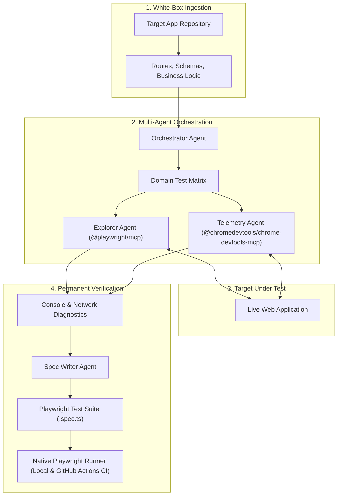

# TobiTests 🚀
### Autonomous Multi-Agent E2E Testing & Diagnostics Framework

[](https://playwright.dev/)
[](https://modelcontextprotocol.io/)
[](https://developer.chrome.com/docs/devtools)
[](https://github.com/TodoTobi/tobitests/actions)
[](https://opensource.org/licenses/MIT)

> **"Don't just test your code with AI. Let AI architect, explore, diagnose, and codify your entire E2E test suite."**

**TobiTests** is an open-source, agentic testing framework inspired by next-generation autonomous QA engines like TestSprite. Built on top of the **Model Context Protocol (MCP)**, it unifies **Playwright** (for reliable, semantic browser interaction) and **Chrome DevTools Protocol** (for deep network and console diagnostics) into an autonomous testing loop.

---

## 💡 The Problem & The Solution

| The Challenge | Why Traditional AI Fails | The TobiTests Way |
| :--- | :--- | :--- |
| **"Vibe Coding" verification gap** | AI writes features fast; human QA and hand-written scripts can't keep up. | Autonomous agents generate comprehensive test matrices directly from your codebase schemas. |
| **Flaky "Computer-Use" UI agents** | Raw pixel-guessing, mouse coordinate drifting, and massive token costs. | **Playwright MCP** uses clean accessibility tree snapshots (`ref` IDs) for deterministic interactions. |
| **Silent runtime exceptions** | Tests pass superficially while the console floods with 500s and unhandled promises. | **Chrome DevTools MCP** acts as an always-on telemetry auditor catching silent failures in real time. |
| **Ephemeral exploratory runs** | An agent clicks around, reports bugs, but leaves no repeatable test code. | **Spec Writer** codifies every validated flow into permanent, native `.spec.ts` files for your CI/CD. |

---

## 🏛️ System Architecture



---

## 👥 The Agent Matrix

* [**Orchestrator**](.agents/orchestrator.md): Parses target repositories, extracts routes/schemas, and partitions testing into bounded functional domains.
* [**Explorer QA**](.agents/explorer-qa.md): Simulates real user behavior, executing happy paths, fuzzing inputs, and validating boundary states.
* [**Telemetry Auditor**](.agents/telemetry-auditor.md): Deep-inspects network status codes, unhandled exceptions, and Core Web Vitals.
* [**Spec Writer**](.agents/spec-writer.md): Synthesizes findings into production-ready, accessible, self-healing Playwright test specifications.

---

## 📂 Repository Layout

```text
tobitests/
├── .agents/                   # Specialized agent prompts and behavioral constraints
│   ├── orchestrator.md        # Central test architecture coordinator
│   ├── explorer-qa.md         # User journey actuator (Playwright MCP)
│   ├── telemetry-auditor.md   # Diagnostic inspector (Chrome DevTools MCP)
│   └── spec-writer.md         # Playwright test generator
├── .github/workflows/         # Automated GitHub Actions CI pipeline
│   └── test.yml
├── docs/                      # Technical documentation & deep dives
│   ├── ARCHITECTURE.md        # Detailed architectural comparison & specs
│   └── TESTING_PROTOCOL.md    # 4-phase testing manual for web projects
├── specs/                     # Generated automated Playwright test suites
├── templates/                 # Reusable test templates & assertions
├── .cursorrules               # Rules for Cursor AI
├── AGENT_INSTRUCTIONS.md      # Direct operating manual for any LLM agent
├── AGENTS.md                  # Team topology and boundary manifest
├── CLAUDE.md                  # Guidance for Claude Code CLI
├── playwright.config.ts       # Global Playwright configuration
├── package.json               # Scripts & dependencies
└── README.md                  # Project overview
```

---

## ⚡ Quick Start

### 1. Installation
Clone the repository and install dependencies:
```bash
git clone https://github.com/TodoTobi/tobitests.git
cd tobitests
npm install
npx playwright install --with-deps
```

### 2. Configure MCP in Your AI Client
Add the following to your AI environment (Cursor, Claude Desktop, Windsurf, Claude Code):

```json
{
  "mcpServers": {
    "playwright": {
      "command": "npx",
      "args": ["@playwright/mcp@latest"]
    },
    "chrome-devtools": {
      "command": "npx",
      "args": ["-y", "@chromedevtools/chrome-devtools-mcp@latest"]
    }
  }
}
```

### 3. Run Autonomous Testing on Any Project
Point your AI agent to this repository and tell it:
> *"Load `AGENT_INSTRUCTIONS.md` and act as the TobiTests QA Architect. Audit the web app at `http://localhost:3000` using the local repository code."*

The agent will:
1. Deconstruct the application schemas and routes.
2. Formulate the test matrix.
3. Walk the flows using Playwright and DevTools.
4. Output verified test specs directly into `specs/`.

### 4. Run the Generated Tests
Execute tests at native speed with Playwright:
```bash
# Run all tests headlessly
npm test

# Run with interactive UI
npm run test:ui

# Run headed (watch the browser)
npm run test:headed
```

---

## 🛡️ License
Distributed under the **MIT License**. See `LICENSE` for more information.
