<div align="center">

# TobiTests 🚀
### Framework Autônomo Multiagente de QA E2E e Telemetria Visual de Escritório

[English](README.md) • [Español](README.es.md) • [Português](README.pt.md) • [简体中文](README.zh.md)

[](https://playwright.dev/)
[](https://modelcontextprotocol.io/)
[](https://developer.chrome.com/docs/devtools)
[](#orquestra%C3%A7%C3%A3o-dual-e-bring-your-own-agent-byoa)
[](https://github.com/TodoTobi/tobitests/actions)
[](https://opensource.org/licenses/MIT)

</div>

> **"Um estúdio autônomo de QA e diagnóstico 100% local e open-source. Una inteligência de código white-box, atuação via Playwright MCP, telemetria CDP do Chrome DevTools e um escritório 2.5D de agentes em tempo real—com zero cotas em nuvem."**

**TobiTests** é um framework de **Garantia de Qualidade E2E Multiagente Autônomo e Telemetria Visual**, desenvolvido como uma alternativa local e white-box a plataformas comerciais em nuvem como o TestSprite. Desenvolvido sobre o **Model Context Protocol (MCP)**, integra agentes como **Antigravity**, **OpenCode**, **Claude Code** ou **Cursor** com subagentes especializados que inspecionam o código-fonte, exploram jornadas no DOM ao vivo, auditam a telemetria de rede/console por meio de um **Oráculo de Detecção de Bugs em 3 Camadas** e geram suítes permanentes e autorreparáveis no Playwright (`.spec.ts`).

---

## ✨ Por que o TobiTests?

| Dimensão | Agentes de "Uso de Computador" (Pixels) | QA SaaS na Nuvem (ex. TestSprite) | **Framework TobiTests** |
| :--- | :--- | :--- | :--- |
| **Motor de Execução** | Coordenadas de mouse e capturas de tela | MicroVMs proprietárias na nuvem | **100% Chromium Local / CI via Playwright e CDP** |
| **Conhecimento do Código**| Caixa-Preta (apenas pixels) | Maioria Caixa-Preta / Upload de PRD | **Caixa-Branca Total** (Rotas, esquemas Zod/Joi, stores, AST) |
| **Profundidade do Oráculo**| Apenas falhas visuais de asserção | Logs padrão HTTP e asserções | **Oráculo em 3 Camadas** (CDP Implícito + Divergência de Estado + A11y) |
| **Observabilidade de Agentes**| Logs de texto no terminal | Dashboard estático na nuvem | **Mapa de Fluxo Interativo + Escritório Isométrico 2.5D** |
| **Custos e Cotas** | Alto consumo de tokens de visão | Assinaturas caras e limites de execução | **100% Open Source, Execuções Ilimitadas em Local e CI** |

---

## 🔄 O Pipeline Autônomo Local de QA em 8 Passos

O TobiTests padroniza a verificação end-to-end em um **Pipeline de 8 Etapas** documentado em [`docs/ARCHITECTURE.md`](docs/ARCHITECTURE.md):

```mermaid
flowchart LR
    S1["1. Bootstrap e Descoberta de Portas/Stack"] --> S2["2. Análise de Código e Rotas"]
    S2 --> S3["3. PRD Normalizado (Ground Truth JSON)"]
    S3 --> S4["4. Geração da Matriz de Testes"]
    S4 --> S5["5. Síntese de Specs (.spec.ts)"]
    S5 --> S6["6. Execução Isolada (.webm e Rastros)"]
    S6 --> S7["7. Triagem e Oráculo em 3 Camadas"]
    S7 --> S8["8. Relatório Gherkin e Autorreparo"]
```



1. **Bootstrap e Descoberta de Portas/Stack:** Detecta portas de frontend/backend, stack de frameworks (`Next.js`, `React + Vite`, `Vue`, `Node.js`) e inicializa o espaço de trabalho.
2. **Análise de Código-Fonte e Rotas:** Análise estática white-box de definições de roteadores, proteções de autenticação, stores de estado (`React Query`, `Zustand`, `Context`) e esquemas de validação.
3. **Geração de PRD Normalizado (`prd-ground-truth.json`):** Sintetiza uma especificação canônica legível por máquina em `workspaces/<projeto>/`.
4. **Geração da Matriz de Testes (`test-matrix.json`):** Divide os testes em **Caminhos Felizes (Happy Paths)**, **Casos de Borda e Fuzzing**, **Fronteiras de Segurança RBAC** e **UI/UX/A11y**.
5. **Síntese de Specs do Playwright (`specs/*.spec.ts`):** Codifica especificações sem esperas arbitrárias (`sleep`), utilizando `getByRole`, `getByLabel` e `getByTestId`.
6. **Execução Isolada com Vídeo (`.webm`), Capturas e Trazas:** Executa testes em contextos isolados capturando vídeos `.webm`, capturas `.png` por etapa e métricas de impacto por rota.
7. **Triagem e Oráculo de Divergência em 3 Camadas:** Avalia cada etapa através da **Camada 1 (CDP Implícito)**, **Camada 2 (Divergência de Estado)** e **Camada 3 (Visual e A11y)**, classificando defeitos de `critical` (`P0`) a `low` (`P3`).
8. **Relatório Gherkin e Autorreparo de Seletores:** Emite cartões de erro em formato **Gherkin (`Given`/`When`/`Then`/`But`)** com coordenadas exatas do código (`root_cause_file`, `root_cause_line`) e repara automaticamente seletores alterados.

---

## 🤝 Orquestração Dual e Bring Your Own Agent (BYOA)

O TobiTests é 100% agnóstico ao agente. A configuração padrão combina **Antigravity** (Cérebro Analítico) com **OpenCode** (Executor Determinístico), permitindo conectar qualquer modelo ou IDE:

* **Motores Suportados:** `antigravity`, `opencode`, `claude-code`, `cursor`, `codex`, `windsurf` e `custom`.
* **Troca Dinâmica de Papéis:** Defina quem é o **Líder Principal** (Etapas 1–4, 7) e quem é o **Executor Secundário** (Etapas 5, 6, 8), ou inverta-os com 1 clique (`--swap-agents`).
* **Modo Solo (Agente Único):** Trabalhando sozinho? Ative o **Modo Solo** (`--mode single`) e o agente selecionado executará todas as 8 etapas sem depender de transições entre pares.
* **Autodescoberta de Ambiente:** Identifica automaticamente ferramentas CLI e regras configuradas (`.cursorrules`, `CLAUDE.md`, `opencode.json`, `CODEX.md`, `.windsurfrules`).

---

## ⚡ Início Rápido

```bash
# 1. Clonar e instalar dependências (raiz e web configuradas automaticamente via postinstall)
git clone https://github.com/TodoTobi/tobitests.git
cd tobitests
npm install

# 2. Iniciar o Dashboard de Observabilidade Visual + Watcher em tempo real (http://localhost:5173)
npm run dev:all

# 3. Compilar pacote de produção (para Vercel / GitHub Pages)
npm run build:web

# 4. Executar suíte de autoverificação Playwright
npm test
```

---

## 🛡️ Licença
Distribuído sob a **Licença MIT**. Consulte [`LICENSE`](LICENSE) para obter mais informações.
