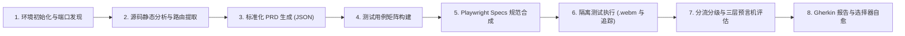

<div align="center">

# TobiTests 🚀
### 自主多智能体端到端 QA 与 2.5D 可视化办公遥测框架

[English](README.md) • [Español](README.es.md) • [Português](README.pt.md) • [简体中文](README.zh.md)

[](https://playwright.dev/)
[](https://modelcontextprotocol.io/)
[](https://developer.chrome.com/docs/devtools)
[](#-自带智能体-byoa-与双智能体协同编排)
[](https://github.com/TodoTobi/tobitests/actions)
[](https://opensource.org/licenses/MIT)

</div>

> **“100% 本地运行、开源的自主 QA 与诊断工坊。融合白盒代码智能解析、Playwright MCP 操作驱动、Chrome DevTools CDP 遥测以及 2.5D 等轴实时智能体办公室——零云端额度消耗。”**

**TobiTests** 是一款开源的**自主多智能体端到端质量保障与可视化遥测框架**，作为 TestSprite 等商业云端测试平台的本地白盒替代方案构建。基于 **Model Context Protocol (MCP)** 标准，它无缝连接 **Antigravity**、**OpenCode**、**Claude Code**、**Cursor** 等主流智能体，通过专业子智能体深度分析源码、遍历 DOM 交互路径、经由**三层缺陷检测预言机**审计网络与控制台运行时遥测，并生成持久化、具备选择器自愈能力的 Playwright 测试套件（`.spec.ts`）。

---

## ✨ 为什么选择 TobiTests？

| 维度 | 像素级“操作电脑”智能体 | 云端 SaaS QA (例如 TestSprite) | **TobiTests 框架** |
| :--- | :--- | :--- | :--- |
| **执行引擎** | 系统鼠标坐标模拟与屏幕截图 | 专有云端虚拟机集群 | **100% 本地 Chromium / CI（Playwright + CDP）** |
| **代码库感知** | 黑盒（仅基于像素） | 大多为黑盒 / 上传 PRD | **全白盒解析**（路由、Zod/Joi 模型、状态库、AST） |
| **缺陷预言机深度** | 仅依赖视觉断言失败 | 基础 HTTP 与断言日志 | **三层预言机**（隐式 CDP + 状态分歧 + 可访问性） |
| **智能体可观测性** | 终端命令行纯文本输出 | 静态云端报表页面 | **交互式路径图谱 + 2.5D 等轴智能体办公室** |
| **成本与额度** | 消耗大量多模态视觉 Token | 昂贵的月订阅与运行次数限制 | **100% 开源，本地与 CI 环境无限次运行** |

---

## 🔄 8 步本地自主 QA 流水线

TobiTests 将端到端自动化测试标准化为 **8 步流水线**，完整定义于 [`docs/ARCHITECTURE.md`](docs/ARCHITECTURE.md)：



1. **环境初始化与端口/技术栈发现：** 自动识别前端/后端端口、应用框架（`Next.js`、`React + Vite`、`Vue`、`Node.js`）并初始化工作区。
2. **源码静态分析与路由提取：** 对路由表、鉴权守卫、状态存储（`React Query`、`Zustand`、`Context`）和验证模型进行白盒静态分析。
3. **标准化 PRD 生成（`prd-ground-truth.json`）：** 在 `workspaces/<project>/` 目录下生成高可读性、机器通用的权威基准规格。
4. **测试矩阵生成（`test-matrix.json`）：** 自动划分用例维度：**常规核心流程 (Happy Path)**、**异常与边界模糊测试**、**RBAC 权限边界**与 **UI/UX/A11y**。
5. **Playwright 规范合成（`specs/*.spec.ts`）：** 生成严谨、无冗余等待（Zero-Sleep）的语义化规范代码（优先使用 `getByRole`、`getByLabel`、`getByTestId`）。
6. **隔离执行与视频录制（`.webm`）、截图与追踪：** 在隔离浏览器上下文中运行测试，实时录制 `.webm` 视频回放、单步 `.png` 截图以及路由触达率指标。
7. **三层预言机评估与缺陷分级：** 依次运行**第 1 层（隐式 CDP 遥测）**、**第 2 层（状态分歧预言机）**和**第 3 层（视觉与可访问性预言机）**，按严重程度自动划分从 `critical` (`P0`) 到 `low` (`P3`)。
8. **最终 Gherkin 报告与选择器自愈：** 输出标准结构化 **Gherkin (`Given`/`When`/`Then`/`But`)** 缺陷卡片，精确标注源码位置（`root_cause_file`、`root_cause_line`），并对未损坏业务但选择器微调的变动执行自动修复。

---

## 🤝 “自带智能体” (BYOA) 与双智能体协同编排

TobiTests 遵循 100% 智能体无关（Agent-Agnostic）架构。默认模式由 **Antigravity**（分析大脑）与 **OpenCode**（执行执行器）协同运作，同时支持接入您日常所用的任何 AI 智能体或 IDE：

* **支持的引擎：** `antigravity`、`opencode`、`claude-code`、`cursor`、`codex`、`windsurf` 和 `custom`。
* **动态角色互换：** 一键指定主导编排者（步骤 1–4、7）与次级执行者（步骤 5、6、8），支持通过命令行（`--swap-agents`）或界面即时调换。
* **单人自主模式（Solo Mode）：** 若仅使用单个智能体，开启 Solo 模式（`--mode single`）即可让当前引擎独立端到端执行所有 8 个步骤。
* **环境规则自动发现：** 自动探测系统中安装的 CLI 并在工作区识别 `.cursorrules`、`CLAUDE.md`、`opencode.json`、`CODEX.md` 等配置文件。

---

## ⚡ 快速开始

```bash
# 1. 克隆代码库并安装依赖（postinstall 会自动递归安装 web 依赖）
git clone https://github.com/TodoTobi/tobitests.git
cd tobitests
npm install

# 2. 启动可视化遥测面板与实时 Spec 监听器 (http://localhost:5173)
npm run dev:all

# 3. 构建生产包（可部署至 Vercel 或 GitHub Pages）
npm run build:web

# 4. 执行平台自愈冒烟测试套件
npm test
```

---

## 🛡️ 开源协议
本项目采用 **MIT 开源许可证**。详情请参阅 [`LICENSE`](LICENSE)。
