# TobiTests Architecture

## Executive Summary

TobiTests is designed around the principle of **Separation of Concerns between Reasoning and Execution**:

* **Reasoning Phase (AI-Driven):** An ensemble of specialized LLM subagents explores, reasons about business logic, interacts with live UI elements, and catches regressions.
* **Codification Phase (Translation):** Findings are solidified into deterministic code specs.
* **Execution Phase (Native Engine):** Playwright's native test runner executes tests across multiple browser engines in parallel at native speed with zero LLM API costs.

---

## Architectural Comparison: TobiTests vs. Desktop AI vs. TestSprite

| Dimension | Desktop "Computer-Use" (e.g. OpenDesk) | Commercial Cloud QA (e.g. TestSprite) | TobiTests Framework |
| :--- | :--- | :--- | :--- |
| **Execution Surface** | OS Level (Mouse coordinates, display pixels) | Cloud Headless Browsers / MicroVMs | Local / CI Browser Engine via CDP & MCP |
| **Code Awareness** | None (Black-Box) | Requirement / PRD docs (Mostly Black-Box) | **Full White-Box** (Direct access to repo source) |
| **Flakiness** | High (Window focus, DPI, screen popups) | Low (Isolated sandboxes) | **Very Low** (Semantic DOM & Accessibility Tree) |
| **Token Efficiency** | Very Low (Heavy screen image processing) | High (Optimized agent prompts) | **High** (Structured accessibility snapshots) |
| **Ownership** | Self-hosted script | Proprietary SaaS subscription | **100% Open Source & Version-Controlled** |

---

## Tri-State Visual Telemetry & E2E Graph Architecture (`rm-*` Primitives)

TobiTests' interactive flow map (`JourneyCanvas.tsx`) is engineered around a **Tri-State Visual Telemetry & E2E Graph Architecture** (`1910×947` reference viewport, `Geist Variable` typography) using the following structural patterns, CSS state primitives, and telemetry models:

### 1. Run-Map (`rm-*`) Component & State Primitives
* **Canvas Stage & Viewport (`div.run-map.rm-flush.rm-panning`):**
  * `div.rm-grid`: Dot/grid background matrix providing spatial orientation during panning and zooming.
  * `div.rm-world.rm-grow.rm-far`: Virtual coordinate stage containing route nodes (`div.rm-frame`), vector overlays (`svg.rm-ov`), particle/effect layers (`div.rm-fx`), entry badges (`div.rm-wl.rm-entry` e.g., `start · 147`), and live execution indicators (`div.rm-live-chips`).
* **Route Node Cards (`div.rm-frame`):**
  * **State Modifiers:** `rm-frame` (base route card), `rm-has-fail` (route where >= 1 test failed or was blocked), `rm-hi` (actively highlighted node on test path hover or selection).
  * **Accessibility Contract:** `role="button"` with `aria-label="<Route Title>, <N> tests reached it"` (e.g., `/dashboard/materias, 9 tests reached it`).
  * **Header Label (`div.rm-wl.rm-lab`):** Displays the route path (`span.rm-ttl`) or semantic page title (`span.rm-ttl-only`).
  * **Thumbnail Preview (`div.rm-thumb`):** Captures the rendered DOM state at that route node.
  * **Node Telemetry Footer (`div.rm-wl.rm-meta`):** Displays tri-state execution counters per route:
    * `<N> failed here` (`span.rm-f`) — Tests whose assertion or runtime exception terminated at this node.
    * `<N> blocked here` (`span.rm-b`) — Downstream tests halted from progressing past this node due to an upstream prerequisite failure.
    * `<N> tests · <M> touches` — Total distinct tests reaching the node and cumulative navigation visits (`touches`).
* **HUD Overlays (`div.rm-hud`):**
  * `div.rm-hud.rm-foot`: Live status pill with braille spinner (`span.rm-ci` -> `⢌⣉⢎⣉`), current agent thought (`span.rm-tv` -> `"Choosing the next step…"`), and active concurrency (`span.rm-d` -> `"· 1 in progress"`).
  * `div.rm-hud.rm-tools`: Viewport controls (`button.rm-btn.rm-primary` `"Follow run"` and `div.rm-zoom` zoom controls).
* **Right Test Drawer (`aside.rm-panel.rm-tests`):**
  * Header with total count badge (`Tests All 148`), scrollable domain-grouped test list (`div.rm-tl` with per-test page touch badges like `2 pages`, `5 pages`), and interactive footer hint (`div.rm-pfoot` -> `"Hover a test to trace its path. Click to replay it."`).

### 2. Feature & Component Comparison Table

| Architectural Layer / Feature | Standard Cloud E2E Graph | TobiTests Implementation (`web/src/`) | TobiTests Advantage & Extensions |
| :--- | :--- | :--- | :--- |
| **Interactive Flow Map Canvas** | `div.run-map` + `div.rm-world` + `svg.rm-ov` | [`JourneyCanvas.tsx`](../web/src/components/JourneyCanvas.tsx) (`.journey-canvas-stage`, `.journey-svg-layer`) | Implements `rm-frame`, `rm-hi`, `rm-has-fail`, non-passive cursor-centered wheel zoom, plus **interactive edge action popovers** showing the exact agent MCP command and timing. |
| **Node Telemetry & Touch Metrics** | `rm-meta`: `<N> failed here · <K> blocked here · <T> tests · <M> touches` | [`JourneyCanvas.tsx`](../web/src/components/JourneyCanvas.tsx) (`testsCount`, `touches`, `failedCount`) | Tracks `testsCount`, `touches`, and dynamic `failedCount` bound to active run state; enriched schema adds `blockedCount` to distinguish direct assertion failures from upstream blockers. |
| **Test Path Tracing & Replay** | `aside.rm-panel.rm-tests` + `div.rm-tl` (`<N> pages` badge) | [`JourneyCanvas.tsx`](../web/src/components/JourneyCanvas.tsx) (`.journey-tests-sidebar`, `getTestTouchedNodeIds`) | Hovering a test illuminates the full multi-screen path left-to-right (`<N> pantallas` + duration pill); clicking opens [`TestDetailModal.tsx`](../web/src/components/TestDetailModal.tsx). |
| **Step-by-Step Replay & Diagnostics** | Cloud execution player with step logs and AI fix prompt | [`TestDetailModal.tsx`](../web/src/components/TestDetailModal.tsx) | Auto-focuses the failing step (`failedIdx`), syncs `.webm` video and per-step screenshots, provides White-Box root cause (`affectedFile`), one-click AI Fix Prompt, and Gherkin/BDD Cerco templates. |
| **Multi-Agent Live Visualization** | `div.rm-hud.rm-foot` (`rm-cap-think` braille spinner) | [`OfficeScene.tsx`](../web/src/components/OfficeScene.tsx) + [`OfficeView.tsx`](../web/src/components/OfficeView.tsx) | Full 2.5D isometric command center ("La Oficina") with 5 specialized agents, real-time SSE/polling sync (`/api/antigravity/live`), standup mode, and workstation telemetry modals. |
| **Multi-Project State & Persistence** | Cloud workspace project switcher | [`useTobiState.ts`](../web/src/hooks/useTobiState.ts) | Zero-cloud local state engine supporting built-in workspaces (`TobiTests`, `VetConnect`) and dynamic custom repositories persisted in `localStorage` and `web/public/data/<project>-state.json`. |

---

## The 8-Step Local Autonomous QA Pipeline

TobiTests standardizes autonomous end-to-end quality assurance into an **8-Step Local Pipeline** executed entirely on the developer's machine or CI runner using `@playwright/mcp` and `@chromedevtools/chrome-devtools-mcp`:

```mermaid
flowchart LR
    S1["1. Bootstrap & Port/Stack Discovery"] --> S2["2. Source Code & Route Analysis"]
    S2 --> S3["3. Normalized PRD Generation"]
    S3 --> S4["4. Test Matrix Generation"]
    S4 --> S5["5. Playwright Spec Synthesis"]
    S5 --> S6["6. Isolated Execution & Capture"]
    S6 --> S7["7. Triage & 3-Layer Oracle"]
    S7 --> S8["8. Gherkin Report & Self-Healing"]
```



### Step 1: Bootstrap & Port/Stack Discovery
* **Objective:** Detect the target repository's runtime topology, framework stack, active local ports, and database seeding scripts before launching a browser.
* **Actions:**
  * Parse `package.json`, `vite.config.ts`, `next.config.js`, `docker-compose.yml`, or `.env` files to identify frontend (`http://localhost:5173`, `http://localhost:3000`) and backend/API (`http://localhost:3001`, WebSocket/CDP) endpoints.
  * Verify server readiness via HTTP health checks and ensure `@playwright/mcp` and `@chromedevtools/chrome-devtools-mcp` are attached.
  * Initialize or load `web/public/data/<project>-state.json` via [`useTobiState.ts`](../web/src/hooks/useTobiState.ts).

### Step 2: Source Code & Route Analysis
* **Objective:** Perform White-Box static analysis of the target codebase to extract the true application state machine.
* **Actions:**
  * Scan router definitions (React Router, Next.js App/Pages Router, Vue Router) to catalog all public, protected, and role-gated routes.
  * Inspect validation schemas (Zod, Yup, Joi, TypeScript interfaces), API client services, state stores (Zustand, Redux, React Query, Context), and authentication guards.
  * Map component trees and interactive elements to identify semantic roles, labels, and `data-testid` hooks.

### Step 3: Normalized PRD Generation (Ground Truth JSON)
* **Objective:** Synthesize findings from source code and existing documentation into a machine-readable Ground Truth specification (Normalized PRD JSON).
* **Actions:**
  * Define functional domains, user roles/personas, entity invariants, expected state transitions, and API contracts.
  * Establish explicit pass/fail acceptance criteria and route graph edges (entry route, target route, expected DOM mutations) so subagents have an authoritative oracle even when human documentation is missing or outdated.

### Step 4: Test Matrix Generation (Happy Path, Edge Cases, RBAC, UI/UX)
* **Objective:** Construct a comprehensive, non-redundant test matrix covering all functional domains.
* **Actions:**
  * **Happy Paths:** End-to-end baseline journeys from entry to completion.
  * **Negative & Boundary Cases:** Empty submissions, malformed inputs (RFC email, password complexity), boundary lengths, XSS/SQLi payloads, and duplicate submissions.
  * **RBAC & Security Boundaries:** Unauthenticated route access redirects, cross-role privilege escalation attempts, and token expiration handling.
  * **UI/UX & Accessibility:** Responsive viewport adaptation (`375px` mobile to `1920px` desktop), keyboard navigation (`Tab`, `Escape`), modal focus trapping, and WCAG contrast/ARIA compliance.

### Step 5: Playwright Spec Synthesis (`specs/*.spec.ts`)
* **Objective:** Translate the test matrix into modular, deterministic Playwright TypeScript specifications.
* **Actions:**
  * The **Spec Writer** generates `specs/<project>-<domain>.spec.ts` using resilient web-first locators (`getByRole`, `getByLabel`, `getByTestId`) and auto-waiting assertions (`expect(locator).toBeVisible()`).
  * Zero arbitrary `waitForTimeout` sleeps are permitted in permanent test specs.

### Step 6: Isolated Execution with Video (`.webm`), Screenshots & Trace Capture
* **Objective:** Execute the synthesized specs and exploratory journeys in isolated browser contexts with full multi-modal evidence collection.
* **Actions:**
  * Run tests with Playwright native video recording (`web/public/evidence/videos/*.webm`), per-step high-resolution screenshots (`web/public/evidence/runs/*.png` and `web/public/evidence/bugs/*.png`), and execution timing metrics (`duration` in `ms`/`s`).
  * Record route graph traversal (`touches`, `testsCount`, `failedCount`, `blockedCount`) to drive [`JourneyCanvas.tsx`](../web/src/components/JourneyCanvas.tsx).

### Step 7: Triage & 3-Layer Divergence Oracle
* **Objective:** Evaluate every executed step and runtime event through three independent verification oracles to eliminate false positives and catch silent bugs.
* **Actions:**
  * **Layer 1 — Implicit Oracle (Chrome DevTools MCP & Runtime Listeners):** Catch `pageerror`, `uncaughtException`, `console.error`, HTTP status `>= 400`, CORS failures, and hung WebSocket/WebRTC/API requests (`> 3000ms`).
  * **Layer 2 — State Divergence Oracle (Playwright MCP + Source Code):** Compare the state machine deduced from source code against the live DOM across views and roles (e.g., verifying that a mutation in View A updates or invalidates cached state in View B).
  * **Layer 3 — Visual & Accessibility Oracle (DOM Snapshot & Computed Styles):** Detect blocked interactive elements (`pointer-events: none`, overlapping z-index layers), layout overflow (`scrollWidth > clientWidth`), broken modal dismissal (`Escape` / backdrop click), and critical ARIA/contrast violations.
  * Classify every confirmed anomaly using the **P0–P3 Severity Rubric** (`critical`, `high`, `medium`, `low`) and distinguish **Failed** tests from **Blocked** downstream tests.

### Step 8: Final Gherkin Report & Selector Self-Healing
* **Objective:** Persist structured bug diagnostics, update the live dashboard state, and self-heal brittle selectors.
* **Actions:**
  * Format every confirmed bug into the strict **Gherkin/BDD (`Given` / `When` / `Then` / `But`)** schema with linked evidence (`screenshot`, `video`, `console_log`, `network_trace`) and exact White-Box root cause (`root_cause_file`, `root_cause_line`).
  * If a test failed due to a benign UI refactor (selector drift) rather than an application bug, automatically heal the locator in `specs/*.spec.ts` and re-verify green execution.
  * Export consolidated diagnostics via the Master Bug Report (`.md`) and Cerco Anti-Regression templates.

---

## Enriched State & Telemetry JSON Schema Contracts

To support multi-project state decoupling (`web/public/data/<project>-state.json`) and Tri-State Visual Telemetry, TobiTests enforces the following TypeScript/JSON schema contracts:

```typescript
export interface JourneyNodeMetrics {
  id: string;
  title: string;
  route: string;
  screenshot: string;
  testsCount: number;
  touches: number;
  failedCount: number;
  blockedCount?: number; // Tri-State metric: tests halted by upstream failure
  category: "auth" | "workspace" | "diagnostics" | "execution" | "API";
}

export interface EnrichedTestStep {
  step: number;
  action: "Navigate" | "Click" | "Fill" | "Assert" | "Inspect" | string;
  target: string;
  expected?: string;
  actual?: string;
  status: "Passed" | "Failed" | "Blocked" | "Skipped";
  duration: string;
  screenshot?: string;
  description?: string;
}

export interface EnrichedBugReport {
  id: string;
  title: string;
  severity: "critical" | "high" | "medium" | "low" | "Critical" | "High" | "Medium" | "Low";
  oracleLayer?: "Layer 1: Implicit" | "Layer 2: State Divergence" | "Layer 3: Visual & A11y";
  status: "Confirmed" | "Resolved" | "Closed";
  section: string;
  runId: string;
  agent: string;
  gherkin: {
    given: string;  // Mapped to dadoQue in UI state
    when: string;   // Mapped to cuando in UI state
    then: string;   // Mapped to entonces in UI state
    but?: string;   // Optional negative/contrastive assertion
  };
  evidence: {
    screenshot: string;
    video: string;
    console_log: string[];
    network_trace: string[];
  };
  rootCause: {
    root_cause_file: string; // Mapped to diagnostic.affectedFile
    root_cause_line: number;
    whiteBoxHypothesis: string;
    recommendedFix: string;
    scopeIn?: string[];
    scopeOut?: string[];
  };
}
```

---

## Dual Surface Auditing: Frontend (`{ page }`) + Pure Backend/API (`{ request }`)

TobiTests audits both full-stack browser UIs and pure headless backend/REST microservices under the same 8-Step Pipeline:
* **Frontend / DOM Surface ([`templates/sample.spec.ts`](../templates/sample.spec.ts)):** Uses Playwright's `{ page }` fixture, `@playwright/mcp`, and `@chromedevtools/chrome-devtools-mcp` to capture DOM snapshots, `.webm` videos, and step screenshots.
* **Pure Backend / API Surface ([`templates/sample-api.spec.ts`](../templates/sample-api.spec.ts)):** Uses Playwright's `{ request }` (`APIRequestContext`) fixture to validate `2xx` schema contracts & latency SLAs (`< 500ms`), `4xx` fuzzing resilience (strictly `< 500`), `401`/`403` RBAC/JWT boundaries, and `Promise.all` concurrency/idempotency. Pure API nodes render the **API Endpoint Telemetry Preview** in [`JourneyCanvas.tsx`](../web/src/components/JourneyCanvas.tsx) and the **Traza HTTP / JSON Inspector** in [`TestDetailModal.tsx`](../web/src/components/TestDetailModal.tsx).
* **Operational Guides:** See [`docs/USER_GUIDE.md`](USER_GUIDE.md) and [`docs/MCP_SETUP.md`](MCP_SETUP.md).

